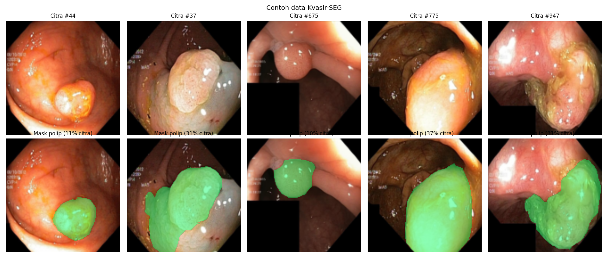
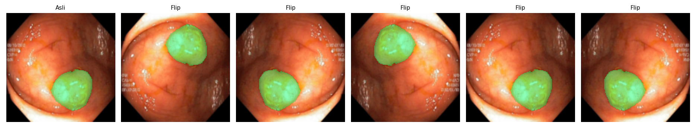
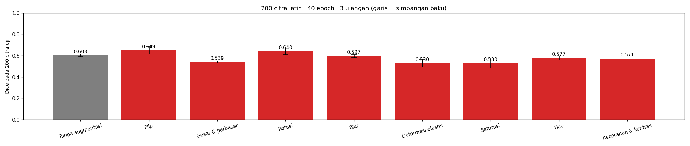
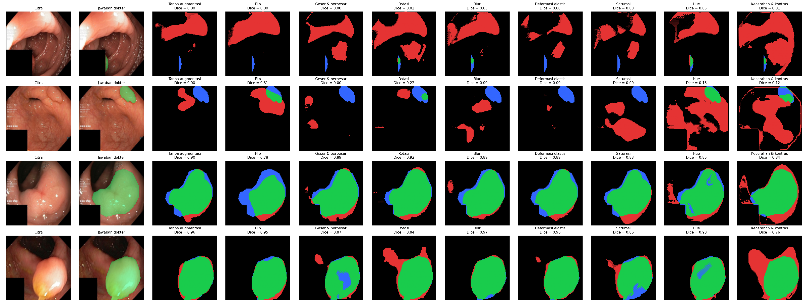

# Segmentasi Polip pada Citra Kolonoskopi dengan U-Net

<!--
  TEMPLATE LAPORAN — Tugas P10 Kecerdasan Buatan (BM25-41204), Teknik Biomedis ITERA.
  Petunjuk lengkap: https://mctm.web.id/ai-bm/tugas

  Cara memakai:
  - Ganti semua teks yang diawali "✍️" dengan tulisan kelompokmu, lalu hapus tanda ✍️-nya.
  - Blok komentar seperti ini adalah petunjuk; tidak tampil di GitHub. Boleh dihapus.
  - Gambar diambil dari folder hasil/ yang dibuat otomatis oleh notebook.
  - Jangan hapus judul-judul bagian (##).
-->

**Tugas P10 — Kecerdasan Buatan (BM25-41204), Teknik Biomedis ITERA**

## Anggota kelompok

| Nama | NIM | Username GitHub | Kontribusi utama |
|---|---|---|---|
| Akhmad Rasyid Alfarabi | 123430096 | cataphract26 | Menjalankan eksperimen di Google Colab |
| Geofany Srydevy Sinambela | 123430014 | geofanysinambela15-maz | pembuat laporan |
| Zahra Salim | 123430033 | zahrasalim222333 | Pembuatan Laporan |

## 1. Pertanyaan

Augmentasi apa yang membantu U-Net menemukan polip pada citra kolonoskopi, dan augmentasi apa yang tidak? Kenapa?

## 2. Data & pengaturan

<!-- Isi dari Bagian 2 notebook. Pastikan CEPAT = False untuk hasil akhir. -->

- Dataset: Kvasir-SEG (1000 citra kolonoskopi + mask polip), diperkecil ke 128 × 128 piksel.
- Data uji: 200 citra (tetap). Data latih: ✍️ citra per ulangan.
- Model: U-Net mini (±0,5 juta parameter), ✍️ epoch, ✍️ ulangan per skenario.
- Dijalankan di: ✍️ (misal: Google Colab T4 / laptop CPU / Mac M1).



## 3. Skenario augmentasi & hipotesis

<!-- Tulis bagian ini SEBELUM menjalankan eksperimen. Commit dulu, baru jalankan.
     Alasan klinis = kenapa variasi ini mungkin (atau tidak mungkin) terjadi pada kolonoskopi sungguhan. -->

| Skenario | Augmentasi (kode) | Alasan klinis | Hipotesis: Dice naik/turun/sama? |
|---|---|---|---|
| Tanpa augmentasi | — | Pembanding | — |
| Flip kiri-kanan dan atas-bawah | v2.RandomHorizontalFlip() & v2.RandomVerticalFlip() | Untuk membuat polip berpindah sisi | Dice sama |
| Rotasi | v2.RandomRotation(degrees=180) | Perputaran kamera di dalam usus cukup sulit dikendalikan dan butuh keahlian khusus | Dice sama |
| Geser & perbesar | v2.RandomAffine(degrees=0, translate=(0.1, 0.1), scale(0.8, 1.2)) | Polip bisa dipotret dari dekat | Dice naik |
| Kecerahan & kontras | v2.ColorJitter(brightness=0.3, contrast-0.3) | Lampu endoskop terangnya tidak selalu sama, tergantung jarak polip dengan lampu | Dice naik |
| Saturasi | v2.ColorJitter(saturation=0.3) | warna pucat akan menyulitkan deteksi. warna pekat akan menyulitkan membedakan mana objek yang diinginkan. nilai yang ditentukan tetap sama | Dice sama |
| Hue (rona warna) | v2.ColorJitter(hue=0.1) | Rona warna tidak perlu diubah untuk melihat petunjuk penting untuk dideteksi | Dice sama |
| Blur | v2.GaussianBlur(kernel_size=5, sigma=(0.1, 2.0)) | Kamera bergerak menyebabkan foto kabur. Blur perlu dikurangi | Dice naik |
| Deformasi elastis | v2.ElasticTransform(alpha=30.0) | Ini dapat membantu untuk meniru bentuk polip, karena bentuk polip dapat berbeda-beda | Dice naik |

Contoh augmentasi yang dicoba:


<!-- Ganti nama file sesuai skenario kalian (lihat isi folder hasil/). -->

## 4. Hasil

| Skenario | Dice (rata-rata ± sb) | IoU (rata-rata ± sb) | Dice tiap ulangan |
|---|---|---|---|
| Tanpa augmentasi | 0.456 ± 0.000 | 0.327 ± 0.000 | 0.456 |
| Flip | 0.440 ± 0.000 | 0.316 ± 0.000 | 0.440 |
| Geser & perbesar | 0.424 ± 0.000 | 0.299 ± 0.000 | 0.424 |
| Rotasi | 0.439 ± 0.000 | 0.312 ± 0.000 | 0.439 |
| Blur | 0.456 ± 0.000 | 0.328 ± 0.000 | 0.456 |
| Deformasi elastis | 0.474 ± 0.000 | 0.348 ± 0.000 | 0.474 |
| Saturasi | 0.422 ± 0.000 | 0.294 ± 0.000 | 0.422 |
| Hue | 0.389 ± 0.000 | 0.269 ± 0.000 | 0.389 |
| Kecerahan & kontras | 0.380 ± 0.000 | 0.258 ± 0.000 | 0.380 |


✍️ tempel tabel dari `hasil/ringkasan.md`



## 5. Analisis peta kesalahan



<!-- Hijau = benar, merah = false positive, biru = false negative.
     Pertanyaan pemandu: Polip seperti apa yang sering terlewat (kecil? datar? warna mirip dinding usus?)
     Apa yang sering dikira polip padahal bukan? Apakah augmentasi memperbaiki kasus sulit? -->

1. Polip yang seeing terlewat (false negative/ biru)
 - Poli berukuran kecil atau tersembunyi (sebagian): Pada sampel bari ke-2 (gambar citra paling kiri baris ke2), polip yang berukuran sangat kecil atau tersembunyi dibatas/lipatan dinding usus mendominasi warna buru (false negative)
  - Polip datar (Flat/Sessile)& kemiripan warna/tekstur: Polip yang tidak menonjol tajam dan memiliki warna/tekstur yang hampir identik dengan dinding usus sekitar (muscosal fold) sering mengalami under-segmentasi (area biru di pinggir mask hijau)
  2. Objek yang sering dikira Polip (False Positive/Mera)
   - Refleksi cahaya/kilatan lampu endoskop (specular highlight): pada baris ke-1 (sampel paling atas), area berwarna merah(False positive) cukup dominan menduduki bagian atas citra, disebabkan oleh pantulan caya endoskop yang cerah di dinding usus yang licin/basah, sehingga model keliru menganggap kontras/pantulan tersebut sebagai polip
    - Lipatan dindinh Usus (Mucosal Fold): lipatan usus yang menonjol memiliki kontur geometris mirip dengan bentuk polip, membuat model cenderung memprediksi daerah terseut sebagai polip.
    3. Apakah augmentasi memperbaiki kasus sulit?
     - Augmentasi yang Efektif (Memperbaiki Kasus Sulit):Flip (Spatial Flip): Menghasilkan skor Dice tertinggi (0.649 \pm 0.035$) dibanding baseline tanpa augmentasi (0.603 \pm 0.013). Augmentasi posisi/orientasi membantu model mengenali polip dari berbagai sudut tanpa merusak fitur tekstur alami.
     Rotasi: Menghasilkan peningkatan stabilitas dan skor Dice (0.640 /pm 0.032)
     - Augmentasi yang Kurang Efektif / Memperburuk Performa:
     Geser & Perbesar (Shift & Scale) & Deformasi Elastis: Menurunkan skor Dice (masing-masing menjadi 0.539 dan 0.530). Pada citra berresolusi kecil (128x128), pergeseran atau deformasi ekstrem justru merusak batas rinci polip kecil dan menghasilkan lebih banyak area False Positive (merah). 
     Kecerahan & Kontras / Saturasi: Tidak secara signifikan membantu mengatasi masalah Specular Highlight (kilatan lampu) dan justru bisa menurunkan nilai Dice.

## 6. Pembahasan & kesimpulan

<!-- Bandingkan hasil dengan hipotesis di Bagian 3. Hipotesis yang ternyata salah tetap bernilai,
     asalkan dijelaskan kenapa. Perbedaan kecil (lebih kecil dari simpangan baku) belum tentu berarti. -->

A. Pembahasan 


B. Kesimpulan
1. 

## 7. Pembagian kerja

<!-- Siapa mengerjakan apa. Penilaian proses kerja dilihat dari riwayat commit tiap anggota. -->

- Akhmad Rasyid Alfarabi: Mengerjakan bagian eksperimen di goole coolab
- Geofany Srydevy Sinambela: Mengerjakan bagian augmentasi dan pembagian kerja
- Zahra salim: Mengerjakan bagian Pembahasan dan referensi

## 8. Penggunaan AI

<!-- Wajib diisi, walau tidak memakai AI (tulis "Tidak memakai AI").
     Contoh: "Claude Code (CLI) untuk menulis skenario augmentasi dan memperbaiki error di Bagian 4.
     Draf Bagian 6 ditulis sendiri, lalu dirapikan bahasanya dengan bantuan AI." -->

✍️

## Cara menjalankan ulang

```bash
uv sync
uv run jupyter lab segmentasi_polip.ipynb
```

Atau buka notebook di Google Colab (Runtime → Change runtime type → T4 GPU).

## Referensi
1. Jha, D., dkk. (2020). Kvasir-SEG: A Segmented Polyp Dataset. *MultiMedia Modeling (MMM 2020)*, 451–462.
2. Ronneberger, O., Fischer, P., & Brox, T. (2015). U-Net: Convolutional Networks for Biomedical Image Segmentation. *MICCAI*. arXiv:1505.04597.
3. Yeung, M., Sala, E., Schönlieb, C. B., & Rundo, L. (2021). Focus U-Net: A novel dual attention-gated CNN for polyp segmentation during colonoscopy. Computers in biology and medicine, 137, 104815. https://doi.org/10.1016/j.compbiomed.2021.104815
4. Safarov, S., & Whangbo, T. K. (2021). A-DenseUNet: Adaptive Densely Connected UNet for Polyp Segmentation in Colonoscopy Images with Atrous Convolution. Sensors (Basel, Switzerland), 21(4), 1441. https://doi.org/10.3390/s21041441
5. Ramzan, M., Raza, M., Sharif, M. I., & Kadry, S. (2022). Gastrointestinal Tract Polyp Anomaly Segmentation on Colonoscopy Images Using Graft-U-Net. Journal of personalized medicine, 12(9), 1459. https://doi.org/10.3390/jpm12091459
6. Patel, K., Bur, A. M., & Wang, G. (2021). Enhanced U-Net: A Feature Enhancement Network for Polyp Segmentation. Proceedings of the International Robots & Vision Conference. International Robots & Vision Conference, 2021, 181–188. https://doi.org/10.1109/crv52889.2021.00032 